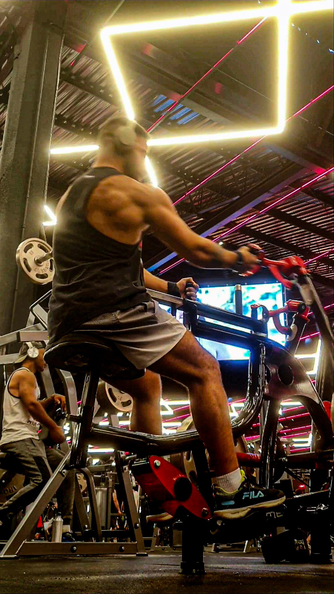

> **Transparência.** O guia é mantido pelo Montinho, personal trainer que atende alunos na Arena 18, uma das academias desta lista. As outras quatro não têm relação comercial com ele.

## O critério desta lista

"Premium" aqui não é selo nem avaliação. Entram as academias do guia que se posicionam como alto padrão: preço publicado na faixa mais alta, plano de agregador exigido no topo ou um pacote de serviços que vai além do salão de treino. Por esse critério, são cinco.

## SIX: clube no 23º andar

A [SIX](/academias/six-alphaville/) ocupa o rooftop do 23º andar do Empresarial 18 do Forte. Além de musculação, lista aulas como ballet fitness, boxe, spinning, dança, pilates e [hot yoga](/modalidades/yoga/), e serviços de spa, recovery, salão de beleza, bar e valet gratuito para membros. Não publica preço; em reportagem da Exame de agosto de 2026, antes da inauguração, o cofundador citou o plano semestral em seis parcelas de R$ 3.900, mais adesão de R$ 600. São valores dados à imprensa, não uma tabela oficial. Funciona das 6h às 22h nos dias úteis.

## Ironberg: escala e 24 horas

A [Ironberg](/academias/ironberg-alphaville/) aposta em tamanho: o site da rede fala em 32 mil m² de musculação e mais de mil vagas de estacionamento gratuito, na Estrada da Aldeinha. Funciona 24 horas, inclusive em feriados. Publica preço: R$ 399 por mês no plano de 12 meses, mais matrícula de R$ 120. É também a única do guia que publica regra para personal de fora.

*Antes e depois do Montinho, que mantém este guia. Resultado individual, contado como história pessoal.*

## NitroGym: dentro do Shopping Tamboré

A [NitroGym](/academias/nitrogym-tambore/) fica no Shopping Tamboré, com o estacionamento do shopping incluso por até 3 horas em todos os planos. Publica a tabela completa: R$ 389 por mês no plano anual, R$ 489 no semestral, R$ 589 no mensal, R$ 289 no plano de fim de semana e diária de R$ 90. Abre das 5h à meia-noite nos dias úteis.

## Arena 18: academia, areia e serviços

A [Arena 18](/academias/arena-18-alphaville/), no Melville Empresarial, junta musculação e funcional com quadras de areia para beach tennis, futevôlei e vôlei. A ficha lista sauna, banho de gelo, spa e massagem, fisioterapeuta, nutricionista, área infantil e coworking. Não publica mensalidade; pelos agregadores, entra a partir do Wellhub Gold e do TotalPass TP 4. O Montinho atende alunos lá.

## Fábrica Premium: serviço de hotel

A [Fábrica Premium](/academias/fabrica-premium-alphaville/), na Estrada da Bela Vista, do lado de Santana de Parnaíba, descreve valet, carregador para carro elétrico, concierge, crioterapia em banheira de gelo, nutricionista e nutrólogo, salão de beleza e café no rooftop, onde fica uma pista de corrida. Não publica preço, e o guia não a encontrou no Wellhub nem no TotalPass.

*O Montinho treinando na Ironberg. Foto dele, tirada na academia.*

## Dá para experimentar antes de assinar

Em academia premium, testar antes faz diferença, porque o contrato costuma ser mais caro e mais longo. Pelas fontes oficiais conferidas em 18/11/2026:

- **NitroGym Tamboré:** day use de R$ 90, pago no local, com acesso a todas as áreas;
- **Ironberg Alphaville:** aula avulsa contratada na recepção, no dia do treino, sem agendamento; o valor só é informado na unidade;
- **SIX e Fábrica Premium:** visita agendada para conhecer o espaço, o que não é a mesma coisa que treinar.

As regras de cada uma, com o canal para comprar ou agendar, estão em [academias com diária e aula experimental](/ferramentas/academias-diaria-aula-experimental-alphaville/).

## Como decidir

O preço maior compra coisas diferentes em cada uma: espaço e 24 horas na Ironberg, praticidade de shopping na NitroGym, areia e serviços de saúde na Arena 18, experiência de clube na SIX e na Fábrica Premium. Antes de assinar, visite no horário em que você vai treinar e pergunte o que está incluído no plano. Para comparar duas delas lado a lado, veja [Ironberg ou NitroGym](/guias/ironberg-ou-nitrogym/) e [Gaviões ou Ironberg](/guias/gavioes-ou-ironberg/); para todas as mensalidades publicadas, a [tabela de preços](/academias/precos/).
