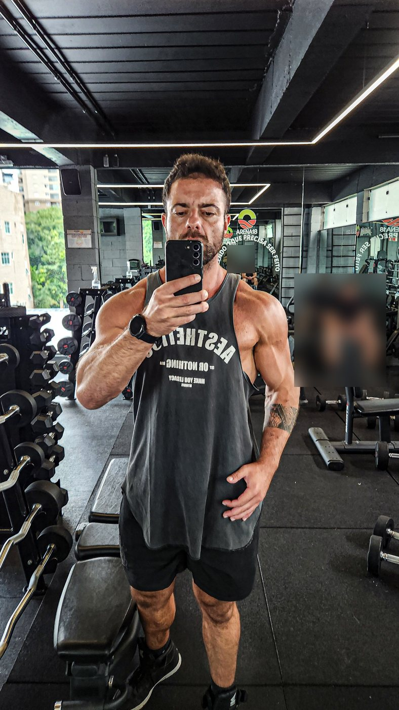

> **Transparência.** O Montinho, personal trainer que mantém este guia, atende alunos na Arena 18, a academia em destaque nesta página. É uma relação comercial; os dados abaixo vêm das fontes públicas listadas no fim.

## Areia e academia no mesmo endereço

Quem procura beach tennis em Alphaville quase sempre acaba em dois lugares separados: a quadra para jogar e a academia para ganhar força. Na [Arena 18](/academias/arena-18-alphaville/), as duas coisas ficam no mesmo prédio. A ficha registra quadras de areia para beach tennis, futevôlei e vôlei, ao lado de sala de musculação e de um estúdio de funcional com HIIT, mobilidade e o método Five.

Entre as academias deste guia, é a única com esportes de areia. Pode haver quadras e clubes na região que não são academias e por isso não têm ficha aqui.

*O Montinho na sala de musculação da Arena 18. Uma pessoa ao fundo foi desfocada.*

## Horários para jogar

Pelas fontes da ficha, a Arena 18 abre das 5h às 23h nos dias úteis. No fim de semana, o site oficial informa das 8h às 23h no sábado e das 8h às 18h no domingo; os agregadores mostram o sábado só até as 18h. Antes de marcar um jogo no sábado à noite, confirme o horário com a academia. Ela aparece também na lista de [academias abertas no domingo](/academias/domingo/).

## O que o guia ainda não sabe

A Arena 18 não publica mensalidade, preço de aula de beach tennis nem valor de aluguel de quadra. Também não há, nas fontes, número de quadras, regra de reserva ou grade de turmas por nível. Pergunte na recepção:

- se a quadra é alugada por hora ou se há turmas com professor;
- se o plano da academia inclui o uso da areia ou se é cobrado à parte;
- como funciona a reserva e quanto tempo antes ela precisa ser feita;
- se há turma para iniciante.

## Wellhub e TotalPass

Pelos agregadores, a Arena 18 entra a partir do plano Gold do Wellhub (R$ 319,99) e do TP 4 do TotalPass (R$ 299,90). As fontes não dizem se o acesso pelo agregador inclui as quadras de areia; confirme antes de contar com isso. Os planos de todas as academias estão em [Wellhub e TotalPass](/academias/wellhub-totalpass/).

*O próprio Montinho, antes e depois de anos de musculação. É a história dele, e não promessa de resultado.*

## Força ajuda a jogar melhor

Beach tennis e futevôlei pedem arranque, mudança de direção e saltos em piso instável. Um trabalho de força e mobilidade fora da quadra costuma ajudar no rendimento e na prevenção de lesões, e a Arena 18 permite fazer as duas coisas na mesma ida. Se você já tem uma limitação ou dor recorrente, converse com um médico ou fisioterapeuta antes; a ficha registra fisioterapeuta entre os serviços da academia.

Quer ver outras academias na mesma região? Veja [academias em Alphaville e Tamboré](/regioes/alphaville/) e [personal trainer na Arena 18](/guias/personal-trainer-arena-18-alphaville/).
