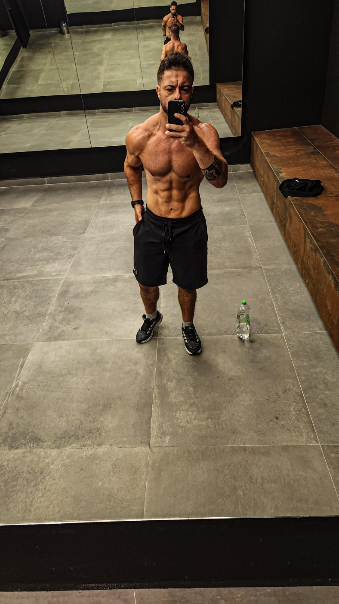

> **Transparência.** Este site é editado pelo Montinho, personal que atende moradores de Barueri. O espaço dele ao final do texto é propaganda, e está identificado como tal.

## Uma prova híbrida pede um treino híbrido

O formato é simples de descrever e duro de executar: corre-se 1 km, faz-se uma estação de exercício, e isso se repete oito vezes. As estações incluem dois ergômetros (SkiErg e remo, 1.000 m cada), trenó empurrado e puxado, saltos com burpee, carregamento de kettlebells, avanços carregando sandbag e, no fim, 100 wall balls. A categoria Open é a padrão; a Pro usa cargas maiores; dá para correr em dupla (Doubles) ou montar um time de quatro no Relay. O resumo está em [Hyrox](/modalidades/hyrox/).

*O Montinho antes e depois de anos de treino. Resultado individual, contado como história pessoal.*

## Cross training dentro da cidade

Duas fichas de Barueri trazem cross training na lista. A [Bluefit Barueri](/academias/bluefit-barueri/), na Av. Trindade, em Bethaville, mostra também GRIT, aula de pula corda e Crossfoot. A [Academia Impacto](/academias/impacto-barueri/), na Vila Engenho Novo, combina cross training, musculação e lutas, e abre às 5h nos dias úteis. Nenhuma das duas menciona Hyrox. Elas servem para o condicionamento geral que a prova exige. O guia de [CrossFit](/modalidades/crossfit/) explica as diferenças entre os estilos de aula.

## Para a parte de corrida

A [Panobianco Barueri Centro](/academias/panobianco-barueri-centro/) lista corrida na esteira e pular corda, além de área de treino funcional. A [Boa Forma](/academias/boa-forma-barueri/), no Jardim Alberto, cita corrida, duatlo, circuitos e funcional. São boas bases para acumular quilômetros entre um treino de estação e outro. Sem carro, uma referência é a Linha 8-Diamante da CPTM passa pela cidade, com estações em Barueri, Antônio João, Jardim Belval e Jardim Silveira; vale escolher a academia pensando no trajeto diário.

## A conta de juntar academia e box

O box que traz Hyrox na lista de atividades é a [BlackSheep Alphaville](/academias/blacksheep-alphaville/), no número 122 da Alameda Araguaia. O endereço é de Alphaville Industrial, dentro do município de Barueri. A tabela da rede marca R$ 480 por mês no ilimitado, R$ 75 a aula avulsa e R$ 400 o mês de teste para quem chega. Já no centro de Barueri, as mensalidades publicadas ficam entre R$ 119,90 e R$ 139,90 com fidelidade. Somar uma academia barata para força e corrida com algumas aulas avulsas no box talvez custe menos que o ilimitado. Faça a conta com a sua frequência real. Uma ressalva: segundo a rede, o endereço que funciona como Training Club oficial é o de Moema.

*Montinho, personal trainer que mantém este guia e atende em Barueri.*

## Quatro perguntas que nenhuma ficha responde

Nenhuma academia citada aqui lista SkiErg, trenó, remo ou bola de wall ball. Antes de fechar plano, confirme:

- quais desses equipamentos existem e se ficam livres fora das aulas;
- se o trenó tem raia para os 25 m de ida e volta;
- em que horários o box tem menos movimento;
- se personal externo entra e quanto paga.

Para checar se um local é clube oficial, use a [ferramenta de busca do próprio Hyrox](https://hyrox-training-finder.hyrox.com/). Se a ideia é ter um profissional ao lado na cidade, leia [personal trainer em Barueri](/guias/personal-trainer-barueri/).
