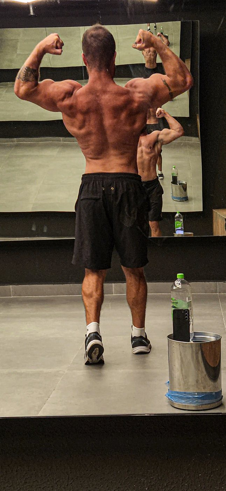

> **Transparência.** Quem mantém este guia é o Montinho, personal trainer que atende em Alphaville e no Tamboré. Ele não dá aula de luta, e o espaço dele no rodapé é anúncio.

## A escola: Templo Jiu Jitsu Culture

A [Templo](/academias/templo-jiu-jitsu-tambore/) fica numa loja do Mackenzie Mall, na Av. Tucunaré, 1498, no Centro Empresarial Tamboré. É a única opção da região com o jiu-jitsu como atividade central. Pelo TotalPass, a grade também tem muay thai e boxe, com turmas femininas das duas.

O horário publicado vai das 6h às 22h nos dias úteis. No sábado, as fontes divergem: o Wellhub mostra das 9h às 12h e o TotalPass, até as 16h. No domingo, fecha. Como é escola de turma, o horário que vale é o da aula, e o Wellhub avisa que é preciso agendar.

Nos agregadores, é uma entrada alta: Gold no Wellhub e TP 4 no TotalPass. Quem vai treinar várias vezes por semana deve comparar com a mensalidade direta, que a escola não publica.

*Montinho, personal trainer que mantém este guia. Ele não dá aula de jiu-jitsu; a musculação costuma entrar como complemento do treino de quem luta.*

## Outra escola: Jacó Fight Club

O [Jacó Fight Club](/academias/jaco-fight-club-alphaville/) fica na Av. Tucunaré, 955, poucos números antes da Templo. A grade junta jiu-jitsu, muay thai, boxe e MMA, com turmas infantis de jiu-jitsu e muay thai. Nos agregadores, entra pelo Platinum no Wellhub e pelo TP 4 no TotalPass. O Wellhub e o TotalPass divergem sobre o horário do fim de semana; confirme antes.

## As academias com jiu-jitsu na grade

- **[VoiFit](/academias/voifit-alphaville/)**, na Av. Alphaville, no Empresarial 18 do Forte. Tem musculação, muay thai e aulas coletivas, abre das 6h às 23h nos dias úteis e funciona também no domingo de manhã. Entra pelo Silver no Wellhub e pelo TP 2+ no TotalPass.
- **[24h Premium](/academias/24h-premium-alphaville/)**, no Alphaville Industrial. Lista boxe, jiu-jitsu e muay thai, abre às 5h e só entra no Wellhub a partir do Gold+.
- **[Academia Scelta](/academias/scelta-alphaville/)**, na Av. Andrômeda, no Alphaville Empresarial. O jiu-jitsu, o muay thai e o boxe chinês aparecem só na página do TotalPass. Pergunte os dias de aula antes de assinar.

Nessas academias, a luta é uma aula entre muitas. A vantagem é usar a mesma mensalidade para tatame e musculação; a desvantagem é ter menos turmas por semana do que numa escola.

## A G13, no Tamboré III

A [G13 BJJ Alphaville](/academias/g13-alphaville-tambore/) fica na Av. Marcos Penteado de Ulhôa Rodrigues, 3272, loja 07, no Tamboré III, do lado de Santana de Parnaíba. É escola da equipe G13, e o plano dá acesso livre a jiu-jitsu, muay thai e boxe, sem limite de aulas por dia. O site cita turmas kids (3 a 10 anos), teens (11 a 15), adultos, para mulheres e para competição, aula experimental gratuita e estacionamento gratuito.

A matrícula é por plano semestral ou anual, e o valor não aparece no site. O guia não encontrou a G13 nas listas do Wellhub e do TotalPass. O horário publicado é de funcionamento, das 6h às 23h nos dias úteis e das 10h às 23h no sábado; peça a grade de aulas da sua faixa antes de ir. As outras opções do bairro estão em [academias no Tamboré](/regioes/tambore/).

## Equipes que ainda não têm ficha

Gracie Barra e Alliance aparecem nas buscas com endereço em Alphaville ou no lado de Santana de Parnaíba. Atenção: parte dos resultados de Gracie Barra Alphaville é de outras cidades com bairro Alphaville, como Votorantim (SP) e Nova Lima (MG). O guia não conseguiu conferir os dados das duas e prefere não publicar o que não verificou. Quem treina numa delas pode [enviar a informação com a fonte](/correcoes/).

## Como escolher

Visite no horário em que você vai treinar e faça a aula experimental. Veja se há turma para iniciantes separada da avançada, quanto custa o quimono e se a escola cobra graduação. Para comparar com Barueri, onde há mais escolas de bairro, leia [jiu-jitsu em Barueri](/guias/jiu-jitsu-barueri/). O panorama de todas as lutas está em [lutas em Alphaville e região](/modalidades/lutas/).
