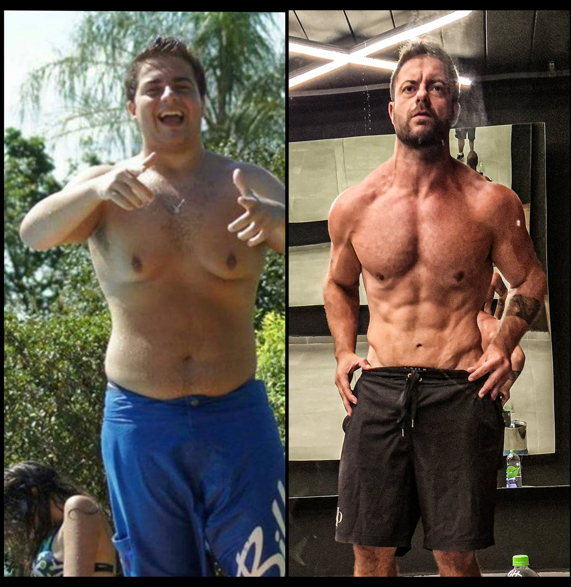

> **Transparência.** O responsável por este site, o Montinho, atua como personal em Alphaville; o anúncio dele fica no pé da página, separado do texto. As informações abaixo saem da [ficha da academia](/academias/24h-premium-alphaville/) e servem para qualquer profissional.

## O nome promete 24 horas, a ficha mostra outro relógio

Antes de montar uma agenda de treino com personal, vale olhar o horário que a própria página do Wellhub mostra para a unidade:

| Dia | Horário publicado |
| --- | --- |
| Segunda a sexta | 5h às 23h |
| Sábado | 7h às 15h |
| Domingo (manhã e começo da tarde) | 8h às 14h |

Ou seja: não há madrugada listada. O guia registra isso como divergência e deixou pendente a confirmação de um possível funcionamento 24 horas para quem é aluno direto. Se a sua sessão ideal é às 3h, pergunte à academia antes de fechar qualquer pacote. A boa notícia é o domingo aberto até as 14h; compare na lista de [academias que abrem no domingo](/ferramentas/academias-abertas-alphaville/).

*Antes e depois do próprio Montinho, que mantém este guia. É a trajetória dele, não promessa de resultado.*

## E o personal que vem de fora?

A ficha cita "Personal trainer" na lista de comodidades, sinal de profissionais ligados à própria academia. Não diz nada sobre quem chega com o seu treinador particular. Regra publicada, o guia não encontrou. Leve estas perguntas ao telefone (11) 4191-3515 ou à recepção:

1. A academia permite profissional externo?
2. Existe taxa? É fixa, mensal ou por sessão?
3. Quem paga essa taxa: o aluno ou o personal?
4. Algum período do dia fica fechado para o acompanhamento externo?
5. O profissional precisa de cadastro antes da primeira aula?

## Uma estrutura que dá margem ao treino individual

Para quem treina acompanhado, a lista de espaços ajuda: áreas de musculação, de pesos livres, de cardio, de treino funcional e de alongamento. Há balança de bioimpedância, tapete de ioga, elevador, banheiro e chuveiro acessíveis e um espaço pensado para cadeirantes. A grade de aulas vai de boxe, jiu-jitsu e muay thai a bike, yoga e mat pilates, o que permite combinar sessões com o personal e aulas coletivas na mesma semana. A ficha também informa estacionamento, inclusive acessível.

## Quanto entra na conta

Valor de mensalidade direta: não divulgado. Pelo Wellhub, a entrada exige o Gold+ (R$ 439,99), o nível mais alto do Wellhub exigido no guia, o mesmo da BlackSheep e da Tecfit. Em cima disso vêm os honorários de quem acompanha você e, se existir, a cobrança da academia pelo acesso de personal externo. Compare com outras opções em [preços das academias](/academias/precos/) e em [Wellhub e TotalPass](/academias/wellhub-totalpass/).

*Montinho, personal trainer que mantém este guia e atende em Alphaville.*

## Se a madrugada for indispensável

Duas academias do guia aparecem listadas como 24 horas: a [Gaviões 24h Alphaville](/academias/gavioes-24h-alphaville/), na Av. Juruá ([personal na Gaviões](/guias/personal-trainer-gavioes-24h-alphaville/)), e a [Ironberg Alphaville](/academias/ironberg-alphaville/), na Estrada da Aldeinha ([personal na Ironberg](/guias/personal-trainer-ironberg-alphaville/)), que publica regra para personal externo. Veja todas em [academias 24 horas](/ferramentas/academias-abertas-alphaville/) e o panorama em [personal trainer em Alphaville](/guias/personal-trainer-alphaville/).
